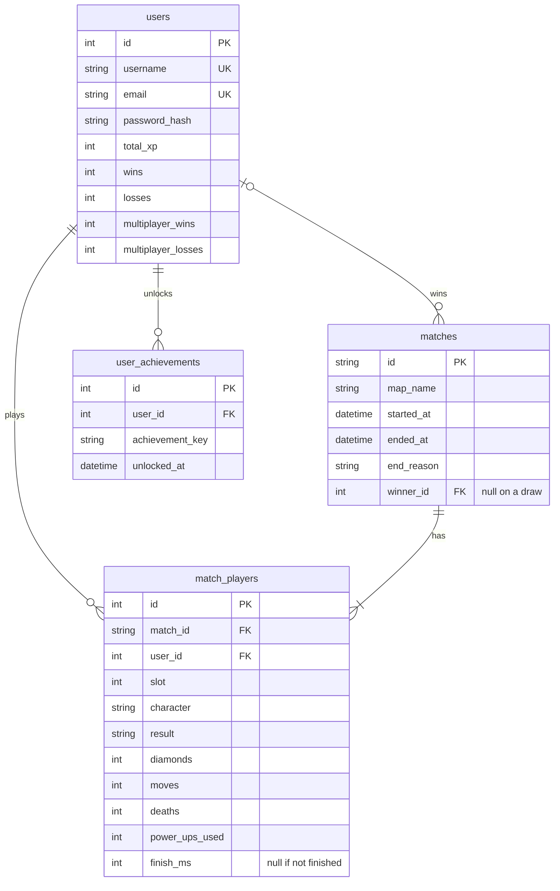

*This project has been created as part of the 42 curriculum by duandrad, gufreire, luiz-dos and pviegas-.*

# Open Sea

## Description

**Open Sea** is a real-time multiplayer maze game played in the browser, built for the ft_transcendence project.

The cold season has arrived and the reef is running out of food. Only an old sea turtle knows the way to the Open Sea, but she can carry only **one fish** on her back, and her price is diamonds. From 2 to 4 players, each one with their own fish, race through the same maze to collect diamonds, escape the sharks and reach the turtle first.

### Main features
- **Online matches** for 2, 3 or 4 players, each one on their own computer, with the server as the only authority on the game state.
- **Lobbies**: create a room, choose the number of players, the map and the match options, pick a fish, get ready and start.
- **Play vs bot**: a computer opponent with three levels (easy, normal, hard).
- **Local mode**: two players on the same keyboard.
- **Spectator mode**: watch a match that is running.
- **Reconnection**: a player who drops (closed tab, lost connection, F5) has 30 seconds to come back to the same match.
- **Match options**: the time of the match, the speed of the sharks and which power-ups can appear.
- **Profile, history and leaderboard**: statistics of every player, the list of their matches, and a ranking of all players.
- **Progression**: XP and levels earned by playing, and achievements.
- **Touch controls** on phones and tablets, and screens that adapt from a phone to a large monitor.
- Interface in **English, Portuguese and French**.
- **HTTPS** through an nginx reverse proxy.

## Game rules

**Goal:** collect the number of diamonds the map asks for and reach the turtle before the other players.

| Map size | Players | Diamonds needed | Sharks | Time |
|---|---|---|---|---|
| Small | 2 | 5 | 4 | 2 min |
| Medium | 2–3 | 10 | 6 | 3 min |
| Large | 2–4 | 10 | 8 | 4 min |

- **Fish:** goldfish, betta, angler and puffer. Two players in the same lobby cannot choose the same fish.
- **Movement:** one cell per key, with a short cooldown between moves, so the fastest finger does not win. Walls and other players block the way.
- **Diamonds:** they belong to whoever takes them first. The map has `goal × players + 1` diamonds, and a player who reached the goal no longer takes any, so the last player can always finish. Their positions are drawn again in every match.
- **Sharks:** they move at random. Touching one kills you: you disappear for 3 seconds and come back at your starting point, keeping your diamonds but losing the power-up you were holding.
- **Power-ups:** one appears every 5 seconds (at most 3 on the map). A player holds one at a time and uses it with the power-up key.

| Power-up | Effect |
|---|---|
| Speed | For 5 s, you move twice as fast |
| Freeze | For 2 s, every other player and every shark stops |
| Enchant | For 5 s, the sharks do not hurt you |

**End of the match**

| Situation | Result |
|---|---|
| A player reaches the turtle with the goal | That player wins |
| The time runs out | The player with the most diamonds wins; a tie at the top is a draw |
| A player leaves or stays disconnected for more than 30 s | That player loses (forfeit) |
| Only one player is left | That player wins |

**Controls**

| | Move | Power-up |
|---|---|---|
| Online and vs bot | W A S D or the arrows | R or L |
| Local, player 1 | W A S D | R |
| Local, player 2 | Arrows | L |
| Phone / tablet | On-screen arrows | On-screen bubble |

## Instructions

### Prerequisites
- **Docker** with **Docker Compose v2** (tested with Docker 29.10 and Docker Compose 5.8)
- **make** and **openssl**, used to create the `.env` file with a random secret
- For development without Docker: **Node.js 22** or newer, and npm

### Run (one command)
```bash
make
```
Wait a few seconds after the command ends (the backend is still starting), then open **https://localhost:8443**. The certificate is self-signed, so the browser shows a warning the first time: choose "Advanced" → "Proceed to localhost". `http://localhost:8080` redirects to HTTPS. From another computer on the same network, open `https://<IP of this machine>:8443`.

The first `make` creates `Transcendance/backend/.env` from `Transcendance/backend/.env.example`, with a random `JWT_SECRET`. The `.env` file is ignored by Git.

| Command | What it does |
|---|---|
| `make` | Creates the `.env` the first time, then builds and starts everything in development mode (Vite dev server and backend with live reload, behind nginx over HTTPS) |
| `make prod` | The same, with the production build: nginx serves the built frontend and the backend runs the compiled code |
| `make down` | Stops the containers; the database is kept |
| `make logs` | Follows the logs of all services |
| `make clean` | The same as `make down` |
| `make fclean` | Stops everything and deletes the volumes (database and certificate) and the images |
| `make re` | `fclean`, then `make` again from zero |

### Environment variables

| Variable | Used for | Default in `.env.example` |
|---|---|---|
| `JWT_SECRET` | Signs the session token | empty; `make` generates one |
| `FRONTEND_ORIGIN` | The address of the browser, for CORS and the cookie | `https://localhost:8443` |
| `COOKIE_SECURE` | The session cookie only travels over HTTPS | `true` |
| `DATABASE_URL` | The SQLite file, in a Docker volume | `file:/app/data/users.db` |

### Run (development, without Docker)
```bash
# terminal 1
cd Transcendance/backend
cp .env.example .env
# in .env: set JWT_SECRET (the file explains how to generate one) and use the local values:
#   FRONTEND_ORIGIN=http://localhost:5173
#   COOKIE_SECURE=false
#   DATABASE_URL=file:./users.db
npm install
npm run dev             # http://localhost:3000

# terminal 2
cd Transcendance/frontend
npm install
npm run dev             # open http://localhost:5173
```

### Tests
```bash
cd Transcendance/backend
npx vitest run
```

### Browser support

The frontend needs a browser from **2023 or newer**:

| Browser | Minimum version | Tested |
|---|---|---|
| Google Chrome | 111 | 158 |
| Microsoft Edge | 111 | 158 |
| Mozilla Firefox | 128 | 160 |
| Safari (macOS and iPhone) | 16.4 | Not tested |

Why these versions:
- **Tailwind CSS v4** depends on Chrome 111, Safari 16.4 and Firefox 128 (it uses `@property` and cascade layers). Firefox 128 is the strictest of our minimums.
- **Vite** builds the JavaScript and the CSS for Chrome/Edge 111, Firefox 114 and Safari 16.4. The CSS files of the screens use nesting (`&`), and the build turns it into plain CSS, so the browsers above do not need to support nesting.
- The canvas of the game draws with `roundRect` (Chrome 99, Firefox 112, Safari 16), and the screens use the `svh` unit (Chrome 108, Firefox 101, Safari 15.4). Both are inside the minimums above.
- Mouse and touch go through **Pointer Events**, and the touch controls appear when the main pointer is a finger (`pointer: coarse`), which works the same way in every browser above.

Known limitations:
- Browsers older than the versions above are not supported: some styles of the screens are lost.
- The certificate is self-signed, so each browser shows its own warning the first time (see [Run](#run-one-command)).
- Safari was not tested: it should work from version 16.4, but this is not confirmed.

## Resources

**Documentation**
- [React documentation](https://react.dev/)
- [Vite documentation](https://vite.dev/guide/)
- [Express documentation](https://expressjs.com/)
- [Socket.IO documentation](https://socket.io/docs/v4/)
- [Prisma documentation](https://www.prisma.io/docs)
- [Tailwind CSS documentation](https://tailwindcss.com/docs)
- [MDN Web Docs](https://developer.mozilla.org/) (CSS, Canvas)
- [i18next documentation](https://www.i18next.com/)
- [Vitest documentation](https://vitest.dev/)
- [nginx documentation](https://nginx.org/en/docs/)
- [Docker Compose documentation](https://docs.docker.com/compose/)

**Videos** (in Portuguese)
- [Curso de React para Completos Iniciantes](https://www.youtube.com/watch?v=2RWsLmu8yVc), Felipe Rocha (Full Stack Club): React from the start
- [Como iniciar um projeto React com Vite em 5 minutos](https://www.youtube.com/watch?v=_Ln1keJif-0), Odair Michael: creating a React project with Vite
- [Se Você Passar Por Esses 5 Desafios, Você Aprendeu React JS](https://www.youtube.com/watch?v=aJR7f45dBNs), Filipe Deschamps: React exercises

### Art credits

The elements of the images (fish, sharks, turtle, diamonds, power-ups, walls, frames) were not drawn by the team. The screens and the maps of the mazes were composed by hand in Canva from these elements: the choice of each element, its position and its adjustments.

- **Fish and sharks:** Designed by [Magnific](https://www.magnific.com).
- **The other elements and the templates of the screens:** taken from [Canva](https://www.canva.com). Some of them may have been created with AI by their own authors.

The same credits are in the game, on the **Credits** page (`/credits`), linked from the footer of every screen.

### How AI was used

The team used AI tools as a support for the work.

- **Learning:** explanations of concepts that were new to us (React, TypeScript, Socket.IO, Tailwind CSS, Docker), alongside the official documentation and our own research.
- **Implementation:** ideas and suggestions on how to build a part of the project (for example, the reconnection or the layouts of the screens), which we then adapted, tested and integrated ourselves.
- **Decisions:** comparing options before choosing one (for example, how to organize the CSS with Tailwind), with the pros and cons of each.
- **Reviews and debugging:** finding mistakes in code that was already written, explaining error messages, and reviewing Pull Requests before the merge.
- **Merge conflicts:** help to understand and resolve the conflicts between branches that changed the same files.
- **Tests:** suggestions of test cases, including edge cases that were easy to miss.
- **Documentation:** help to write clearer comments and descriptions of functions and files.

Everything suggested by AI was read, understood and tested before it entered the project.

## Team Information

| Member | Role | Responsibilities |
|---|---|---|
| Duarte (duandrad) | Project Manager (PM), Developer | Rendering of the game in the browser (with Luiz), leaving a match, database and Prisma, match persistence, progression (XP, levels, achievements) |
| Guilherme (gufreire) | Developer | nginx and HTTPS, Docker for production, internationalization, Privacy Policy and Terms of Service, history/statistics APIs and pages, leaderboard, first Tailwind setup |
| Luiz (luiz-dos) | Technical Lead, Developer | Game design and choice of the art, game engine, networked game, local mode, match options, bot, screens and Tailwind, code reviews |
| Pedro (pviegas-) | Product Owner (PO), Developer | First version of the web app (React + Express), authentication, socket authentication, lobbies, spectator mode, form validation, one-command deploy |

## Project Management

- **Organization:** the work was split into stages (game engine, rendering, socket authentication, networked game, local mode, reconnection, database, extras), each with an owner. Stages that did not depend on each other ran in parallel.
- **Git workflow:** one branch per feature, Pull Requests into `main`, and a review by another member before merging.
- **Tasks:** GitHub Issues, one issue per task or bug.
- **Communication:** WhatsApp for day-to-day messages, Discord for voice meetings, and meetings in person at 42 Lisboa.

## Technical Stack

| Part | Technology | Why |
|---|---|---|
| Frontend | React 19 + TypeScript, Vite | The game has many screens (menu, lobbies, profile, match...) that share pieces; components and hooks keep each screen small. Vite gives a fast development server and the production build |
| Styling | Tailwind CSS v4 | Utility classes next to the markup, with the colors, fonts and fluid sizes of the game as named classes (`text-sea-light`, `text-story`, `gap-screen`...). The base pieces (frame, buttons, boxes) are component classes, in cascade layers so a utility always wins over them |
| Game rendering | HTML5 Canvas | The maze is a grid of sprites redrawn many times per second |
| Backend | Node.js, Express 5 + TypeScript | The same language on both sides; the game types are shared between server and browser |
| Real time | Socket.IO 4 | Rooms for lobbies and matches, automatic reconnection, and it starts over HTTP long-polling before upgrading to WebSocket, so it still works where WebSockets are blocked |
| Database | SQLite | One file and no extra server, enough for the load of the project |
| ORM | Prisma 7 | A clear schema in one file, migrations, and typed queries |
| Authentication | argon2, JWT in an httpOnly cookie | argon2 is a slow, salted hash made for passwords. The JWT in an httpOnly cookie cannot be read by JavaScript in the page, which protects the session from XSS |
| i18n | i18next / react-i18next | Every text of the interface and every error of the server goes through a translation key, in three languages |
| Reverse proxy | nginx | HTTPS and one entry point for the frontend, the API and the WebSocket |
| Containers | Docker, Docker Compose, make | The whole application starts with one command |
| Tests | Vitest | Fast, TypeScript without setup; the game engine, the bot, the lobbies, the authentication and the persistence are covered |

**Architecture:** the server runs every match (an authoritative server). Browsers only send commands (move, use a power-up) and draw the state the server sends about 20 times per second, so a player cannot cheat by changing the client.

```
browser ──HTTPS──▶ nginx ──┬── the frontend (Vite dev server with make, the built React app with make prod)
                           ├── /api        ──▶ backend (Express)
                           └── /socket.io  ──▶ backend (Socket.IO) ──▶ SQLite (Prisma)
```

## Database Schema

SQLite, managed by Prisma (`Transcendance/backend/prisma/schema.prisma`, with its migrations in `prisma/migrations`).



| Table | What it stores | Relations |
|---|---|---|
| `users` | The account (unique username and email, argon2 hash of the password), the totals of wins and losses, and the XP | — |
| `matches` | One online match: the map, when it started and ended, why it ended, and the winner | `winner_id` → `users.id` (set to null if the user is deleted) |
| `match_players` | One player in one match: the slot, the fish, the result and the numbers of the match (diamonds, moves, deaths, power-ups, time to finish) | `match_id` → `matches.id` and `user_id` → `users.id` (deleted with them); one row per slot of a match |
| `user_achievements` | An achievement unlocked by a user, and when | `user_id` → `users.id` (deleted with it); a user unlocks each achievement once |

The level shown on the profile is calculated from `total_xp`.

## Features List

| Feature | Who | What it does |
|---|---|---|
| Register and login | Pedro | Accounts with email and password, login with the username or the email, passwords hashed with argon2, session in an httpOnly cookie, validation in the browser and on the server |
| Lobbies | Pedro, Luiz | Create, choose players/map/options, pick a fish, ready, start, kick |
| Game engine | Luiz | Movement, diamonds, sharks, power-ups, deaths, end of the match, with unit tests |
| Game rendering | Duarte, Luiz | Canvas drawing of the map, fish, sharks and HUD |
| Online match | Luiz, Pedro | Server-side matches over Socket.IO, countdown, state broadcast |
| Local mode | Luiz | Two players on the same keyboard |
| Bot | Luiz | A computer opponent with three levels, that plays with the same rules and options as a person |
| Reconnection | Luiz, Guilherme | Back to the same match within 30 s |
| Spectator mode | Pedro | Watch a running match |
| Leave a match | Duarte | Confirmation before leaving; leaving counts as a forfeit |
| Match options | Luiz | Time, shark speed and power-ups chosen by the host |
| Match persistence | Duarte | Every online match and each player's result saved in the database |
| Statistics, history and leaderboard | Guilherme | The totals of a player, the list of their matches and the ranking of all players |
| Progression | Duarte | XP and levels from every match, and achievements (win without dying, exit in under 60 moves, 10 online wins) |
| HTTPS / nginx | Guilherme | One HTTPS entry point for the whole application |
| One-command deploy | Pedro | `make` creates the `.env` and starts everything |
| Translations | Guilherme | English, Portuguese and French, with a language switcher; the server sends error codes that the browser translates |
| Privacy Policy, Terms of Service | Guilherme | Pages linked from every screen |
| Screens and styling | Luiz, Guilherme | The screens of the game, with Tailwind CSS, from a phone to a large monitor |
| Touch controls | Luiz | Playable on phones and tablets |

## Modules

| Module | Type | Points | Who | How it was implemented |
|---|---|---|---|---|
| Frameworks for frontend and backend | Major | 2 | All | React on the frontend, Express on the backend |
| Real-time features (WebSockets) | Major | 2 | Pedro, Luiz | Socket.IO rooms for lobbies and matches; disconnections handled; the state is broadcast to the players and spectators of each room |
| Web-based game | Major | 2 | Luiz, Duarte | Open Sea, with clear rules and win/lose conditions |
| Remote players | Major | 2 | Luiz, Guilherme | Each player on their own computer; reconnection within 30 s |
| Multiplayer (3+ players) | Major | 2 | Luiz | Up to 4 players in the same match, all moves validated by the server |
| AI opponent | Major | 2 | Luiz | A bot with three levels; it plays with the same rules, maps and options as a person, and can win |
| Spectator mode | Minor | 1 | Pedro | Watch a running match from the lobby list |
| Game customization | Minor | 1 | Luiz | Match time, shark speed, power-ups and map, with defaults |
| Multiple languages | Minor | 1 | Guilherme | 3 languages and a language switcher; every text and server error is translated |
| Game statistics and match history | Minor | 1 | Guilherme, Duarte | Totals, the list of matches with date, map, fish and opponents, and the leaderboard |
| Gamification | Minor | 1 | Duarte | XP, levels and achievements, saved in the database and shown on the profile |
| ORM | Minor | 1 | Duarte | Prisma over SQLite |
| Support for additional browsers | Minor | 1 | All | Firefox and Edge tested in addition to Chrome, with the minimum versions and the limitations documented (see [Browser support](#browser-support)) |
| **Total** | | **19** | | |

**Why these modules**
- **Frameworks, WebSockets, web game, remote players, multiplayer:** they are the core of a real-time multiplayer game; the game was designed for them from the start.
- **AI opponent:** an online match needs at least two people connected at the same time. With the bot, one person can play a full match whenever they want, at the level they choose, on any map and with any options.
- **Spectator mode, customization, statistics, gamification:** they give players a reason to come back and make the lobbies more lively.
- **Multiple languages:** so that people who do not speak English can also play. Portuguese is the language of the team and of the country where we study, and French is the language of the country where 42 was founded.
- **ORM:** one schema with migrations instead of SQL written by hand in several files.
- **Additional browsers:** the game must work for whoever opens it, not only on Chrome.

## Individual Contributions

### Duarte
**Role:** Project Manager (PM), Developer

**What I did**
- **Rendering of the game** (with Luiz): the canvas drawing of the map, fish, sharks and HUD, and the game screen that presents the state sent by the server.
- **Leaving a match:** a confirmation before leaving, so an accidental key does not end the match; leaving counts as a forfeit and the game input is disabled while the dialog is open. In spectator mode, the same button stops watching without a confirmation.
- **Database and Prisma:** Prisma 7 with the `User`, `Match`, `MatchPlayer` and `UserAchievement` models, the baseline, match-history and gamification migrations, and the `DATABASE_URL`/Docker volume setup so the SQLite database survives container restarts.
- **Match persistence:** every completed online match saved in one transaction with all its players and results; local matches are ignored, unfinished matches are rejected, and exits are stored as forfeits. Covered by unit and integration tests, including the rollback when an update fails.
- **Progression:** XP for finishing a match (10, plus 10 for a win, none for a forfeit), level `floor(totalXp / 100) + 1`, and the `no_death_win`, `fast_exit` and `ten_online_wins` achievements. Added the authenticated `/progression` endpoint and the Profile UI in English, French and Portuguese.
- **Bot errors and translations:** localized the bot errors and fish names, and reported a missing login as `auth.notLoggedIn`.
- **Project management:** organised the work into stages with one owner each, tracked the tasks in GitHub Issues, reviewed and merged the feature PRs (#16, #18, #22 and #25), and coordinated the parallel branches.

**Difficulties**
- **Atomic match persistence:** a finished match has to be written with every player in one transaction, while XP, achievements and the old win/loss counters are updated in the same operation. A failure in any update must leave no partial match; the integration test forces a counter failure and checks the rollback.
- **A database with two drivers:** the new match and progression data used Prisma, but the authentication and sockets still used better-sqlite3. Both had to open the same file in development and in Docker, without breaking the existing login flow. This is why the ORM migration is not backend-wide yet.
- **Progression edge cases:** local matches must not affect the profile, unfinished matches and players without an account must be rejected, a forfeit gives no XP, a draw still counts as a played match, and each achievement must unlock only once. Each rule has a test.
- **Two sources of truth for the results:** the user table still had the old win/loss counters, while the new history reads from `match_players`. I updated the counters for compatibility, but the statistics were later recomputed from the match rows, so the two had to agree.
- **Coordinating parallel work:** the branches touched the same game state, screens and translations, and `main` moved quickly. As PM, I kept the staged plan and GitHub Issues up to date, reviewed and merged the feature PRs, and checked the integrations so work from one branch did not break another.

### Guilherme
**Role:** Developer

**What I did**
- **NGINX and HTTPS:** added the nginx service to create a single https entry point for the whole app, added TLS 1.2/1.3, a self-signed certificate generated on the first start, http -> https redirect.
- **Docker for production:** the nginx image builds the React app and serves it, a production Dockerfile builds the backend, and Compose publishes 8080/8443 with volumes for the database and the certificate.
- **i18n:** i18next with English, Portuguese and French, a language switcher in the footer of every screen. I translated all the screens, the fish and map names and the errors.
- **Privacy Policy and Terms of Service:** added the privacy policy and terms of service pages, linked from the footer of every screen.
- **Statistics, history and leaderboard:** created the leaderboards page displaying the statistics of the user matches, this was done with `GET /users/:id/matches`, `/users/:id/stats` from the schema created through Prisma. Also, created the history page which records every type of information from the user matches (date, map, fish, opponents, result, diamonds, power-ups), and made them accessible even without logging in.
- **Tailwind CSS:** the first Tailwind setup (dependency, Vite plugin and CSS import) and the conversion of the first screens to utilities, keeping the look of the existing CSS.
- **Reconnection** (with Luiz): merged the reconnection work into my branch, translated the reconnecting, spectating and leave-confirmation texts, and resolved the conflicts in `GameScreen`, `LobbySelect` and `OpenSea`.

**Difficulties**
- **Full Stack:** This being my first full stack project showed me a lot of new things, from new languages, to new concepts, to completely different ways to architecture a project, which was difficult to manage in such a short time.
- **Two formats for the database path:** `DATABASE_URL` is a Prisma `file:` URL but the SQLite driver wants a filesystem path. I wrote `resolveDatabasePath()` for absolute and relative URLs and `:memory:`, created the parent directory when needed, and covered the cases with tests.
- **Translations while everyone was writing code:** new strings arrived from every branch and the three dictionaries had to be kept identical. Portuguese and French are longer than English, and the error messages had names and numbers interpolated in English, which cannot be translated as a sentence. Sending a code with parameters and translating it in the browser solved that.
- **Statistics from two sources of truth:** the user table still had win/loss counters from before match persistence, so I recomputed everything from the `match_players` rows. Draws do not count towards the win percentage, accounts with no matches are left out of the ranking, and ties are broken case-insensitively by name so the order is stable.
- **Work in parallel:** it was difficult working in group, as we had different learning speeds and working speeds, but we managed to communicate to smooth the project flow.

### Luiz
**Role:** Technical Lead and developer.

**What I did**
- **Game design and art:** the idea of Open Sea, its rules, the maps, the fish, and the choice of the art.
- **Game engine:** movement with a cooldown, diamonds, sharks, power-ups, deaths and the end of the match, covered by unit tests.
- **Online match:** the server runs every match and sends the state to the players and spectators, and the browser only sends commands.
- **Local mode**, **match options** (time, shark speed, power-ups) and the **bot** with three levels.
- **Reconnection** (with Guilherme): a player who drops keeps their seat and has 30 seconds to come back to the same match.
- **Rendering** of the game on the canvas (with Duarte), and the **touch controls** for phones and tablets.
- **Screens:** the move of the screens to Tailwind CSS, and the layouts that adapt from a phone to a large monitor, in the three languages.
- **Technical Lead:** the technical decisions, the reviews of the Pull Requests, and the merges between branches that ran in parallel.

**Difficulties**
- **Learning many new things in a short time:** React, TypeScript, Socket.IO and Tailwind CSS were new to me. I learned them from the official documentation, YouTube videos (see [Resources](#resources)) and explanations from AI tools.
- **A fair game over the network:** the browsers cannot decide anything, or a player could cheat. All the rules had to run on the server, and the browser only draws what it receives.
- **Players who drop in the middle of a match:** the match has to wait for them for a short time, without blocking the other players, and give them back the same seat.
- **Screens in three languages and every screen size:** Portuguese and French texts are longer than English ones, and they cut names and buttons on small phones. I tested every screen in each language and each size, and adjusted the layouts until everything fit.
- **Work in parallel:** with four people changing the same files, the merges had conflicts that needed care so that nobody's work was lost.

### Pedro
**Role:** Product Owner (PO) and developer.

**What I did**
- **First version of the web app:** started the repository with React and Express, the first lobby system, and placeholder games to test Socket.IO and the profile.
- **Authentication:** registration and login with email and password, hashed with argon2, and the session as a JWT in an httpOnly cookie. The /me, /logout and /session routes, and the api.ts helper so every request sends the cookie. Login works with the username or the email.
- **Socket authentication and lobbies:** the game connection only opens with a valid login cookie, lobbies and match results use the logged-in user instead of a name sent by the browser, and a user can only be in one lobby at a time.
- **Spectator mode:** the WATCH button on the lobby list, the server side to follow a running match without playing, and the spectator screen.
- **Form validation:** the same rules in the browser and on the server: required fields, username of 3-16 letters, numbers or _, a valid email, and a password of 8-128 characters with a letter and a number.
- **One-command deploy:** the development setup behind nginx over HTTPS with live reload, one .env.example, and a Makefile: make creates the .env with a random JWT_SECRET and starts everything.
- **Product Owner:** provided the initial prototype of the app, maintained the repo, helped validate my teammates' work.

**Difficulties**
- **Learning a lot of new things:** this was my first full stack project and it was very difficult to figure out how to even start, had to learn many new concepts some of which I feel like I didn't master but everything came in together in the end and I feel like we did a good job.
- **Working in a bigger team:** this was definitely one of the pain points, a bigger team needs to have clear organization and this was my first time doing it so there was some friction to our work flow until we got used to it.
- **Connections:** I did some of the backend in particular sockets, lobbies etc and that took some getting used to by having to keep track of everything.
